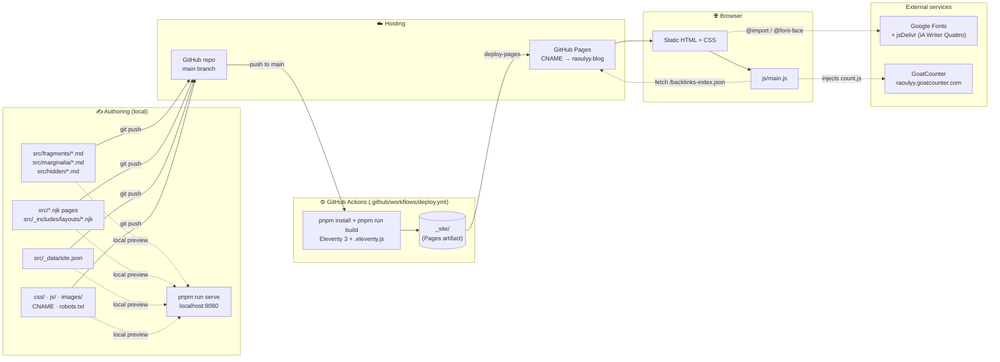
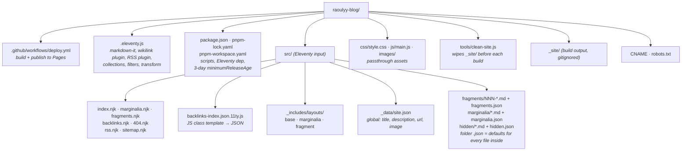
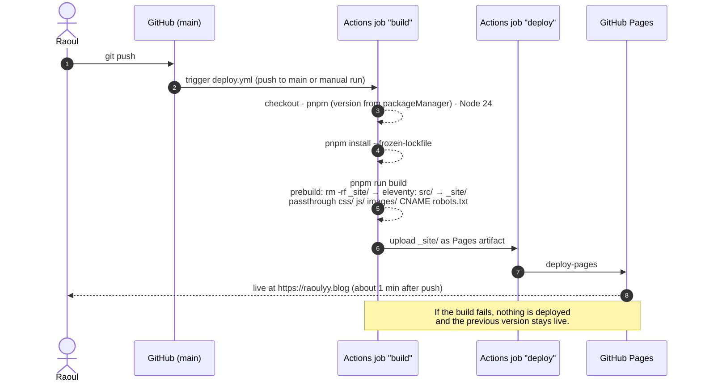
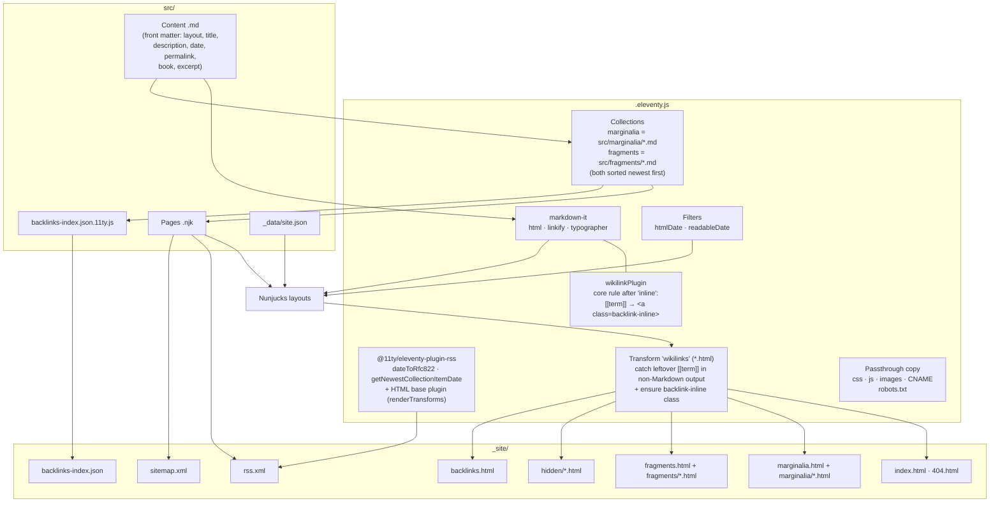
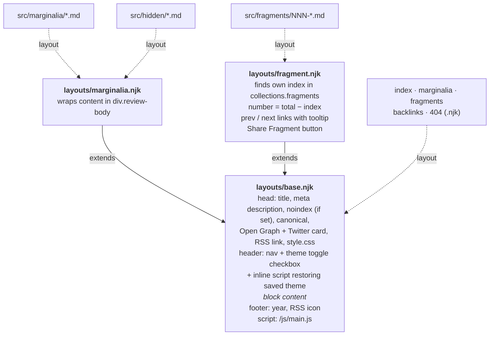
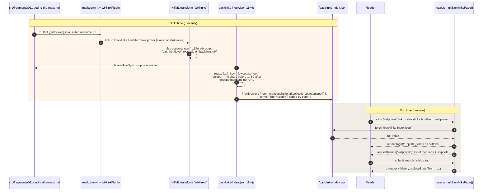
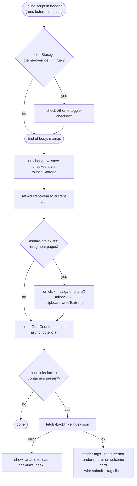
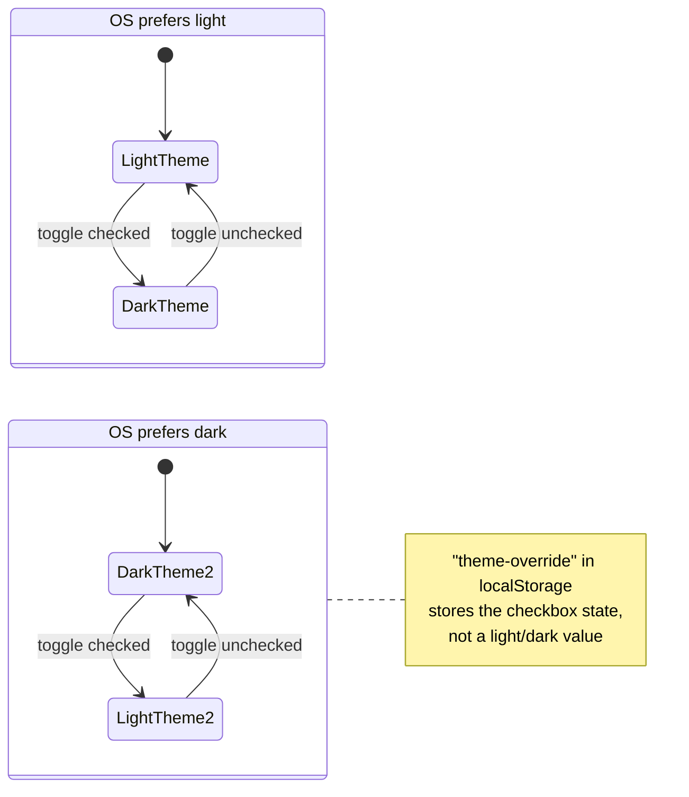
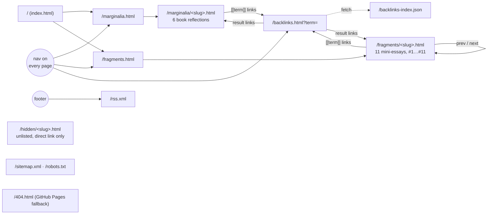

# Architecture

How raoulyy.blog works technically, from writing Markdown to a page in someone's browser.

**In one sentence:** Markdown and Nunjucks sources in `src/` are compiled by Eleventy 3 into `_site/`. On every push to `main`, a GitHub Actions workflow runs that build and publishes `_site/` to GitHub Pages at `raoulyy.blog`. On the client, one vanilla JS file handles the theme toggle, sharing, analytics, and the backlinks search.

---

## 1. System overview

---

## 2. Repository layout

---

## 3. Build & deploy pipeline

Publishing is just `git push`. GitHub Actions builds the site from a clean checkout and hands `_site/` to GitHub Pages:

All actions in the workflow are pinned to commit SHAs. Two deploys never run at the same time (`concurrency: pages`).

Local scripts:

| Script | What it does |
|---|---|
| `pnpm run build` | `prebuild` (wipe `_site/`) → `eleventy`, same as CI |
| `pnpm run serve` | Eleventy dev server with live reload on `localhost:8080` |

---

## 4. Inside the Eleventy build

### Template inheritance

`rss.njk`, `sitemap.njk` and `backlinks-index.json.11ty.js` render without a layout and are excluded from collections.

### Which page reads which data

| Output | Source | Reads |
|---|---|---|
| `/index.html` | `index.njk` | static text |
| `/marginalia.html` | `marginalia.njk` | `collections.marginalia` → title, `book` (split on ` \| `), date |
| `/fragments.html` | `fragments.njk` | `collections.fragments` → number, title, description, date |
| `/fragments/*.html` | `fragment.njk` layout | `collections.fragments` for numbering + prev/next |
| `/marginalia/*.html` | `marginalia.njk` layout | post content |
| `/hidden/*.html` | `marginalia.njk` layout (via `hidden.json`) | excluded from collections, so not listed, not in RSS, backlinks, or sitemap; `noindex` meta tag |
| `/rss.xml` | `rss.njk` | fragments + marginalia merged, sorted by date, full content with links made absolute (`renderTransforms` with `site.url`) |
| `/backlinks-index.json` | `backlinks-index.json.11ty.js` | collections + **raw `.md` files from disk** |
| `/backlinks.html` | `backlinks.njk` | shell only; filled in by `main.js` |
| `/sitemap.xml` | `sitemap.njk` | `collections.all`, so every page except those with `eleventyExcludeFromCollections` (404, hidden, rss, backlinks index) |

---

## 5. Wikilinks & backlinks

The blog's "digital garden" feature. Writing `[[willpower]]` in a post does two things:

1. **At render time** it turns into a link: `<a href="/backlinks.html?term=willpower" class="backlink-inline">willpower</a>`.
2. **At build time** it gets indexed into `backlinks-index.json` together with a short text snippet around it.

The backlinks page then works entirely in the browser.

Terms are case-insensitive (`[[Willpower]]` and `[[willpower]]` share one entry). Only `src/fragments/` and `src/marginalia/` are indexed.

---

## 6. Client-side runtime (`js/main.js`)

A single script, loaded at the end of `<body>` on every page. The only exception is restoring the saved theme, which happens in a tiny inline script right after the toggle in `base.njk`, so the page never paints in the wrong theme first:

### Theme toggle: CSS only, JS just remembers the choice

The checkbox **inverts** whatever the OS prefers. CSS does the switch with `:root:has(#theme-toggle-checkbox:checked)` inside `prefers-color-scheme` media queries. JS only saves (`main.js`) and restores (inline script in `base.njk`) the checkbox state.

Design tokens (`--bg-color`, `--text-main`, `--accent`, `--text-highlight`, …) are set in `:root` at the top of `css/style.css`. Fonts: iA Writer Quattro (body, via jsDelivr), Fraunces / Playfair Display (titles), Inter (fallback), all loaded from Google Fonts / jsDelivr.

---

## 7. URL map

---

## 8. Content model

| Field | Marginalia | Fragments | Used by |
|---|:-:|:-:|---|
| `layout` | `layouts/marginalia.njk` (set by `marginalia.json`) | `layouts/fragment.njk` (set by `fragments.json`) | Eleventy |
| `title` | ✓ | ✓ | `<title>`, OG/Twitter, listings, RSS, backlinks |
| `description` | ✓ | ✓ | meta description, fragment card subtitle, RSS `<description>` |
| `date` | ✓ | ✓ | sort order, numbering, `<time>`, RSS `pubDate` |
| `permalink` | ✓ | ✓ | output URL (file names like `011-…` don't affect the URL) |
| `book` | `"Title \| Author"` | – | marginalia listing subtitle |
| `excerpt` | optional | – | currently not rendered anywhere |

Fragment numbers (`#11`) aren't stored anywhere. They come from each fragment's position in the date-sorted collection, so adding one with an earlier date renumbers the ones after it.

---

## 9. Observations & quirks

Found while analysing the project. None of them break the site, but they're good to know:

- **Two wikilink mechanisms:** the markdown-it plugin handles Markdown, and the HTML transform handles everything else (and re-checks link classes). The transform alone would be enough, but the plugin avoids regex-on-HTML for content.
- **Backlink snippets come from raw Markdown**, so inline HTML or Markdown syntax next to a `[[term]]` can show up in the snippet text (it's escaped, so it's safe).
- **`og:type`** is `article` only for URLs containing `marginalia`. Fragments get `website`.
- **`src/404.njk`** nests its own `<main>` inside the layout's `<main>`.
