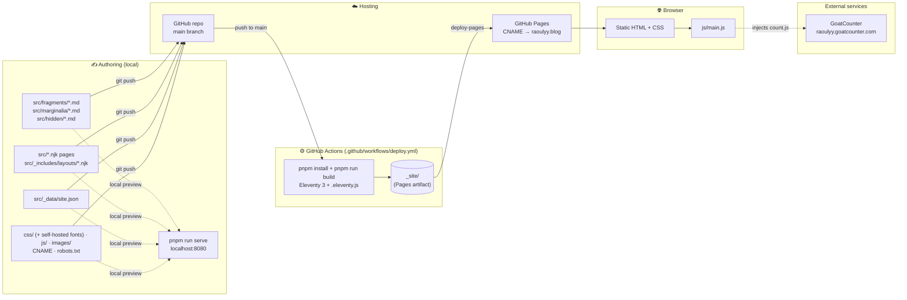
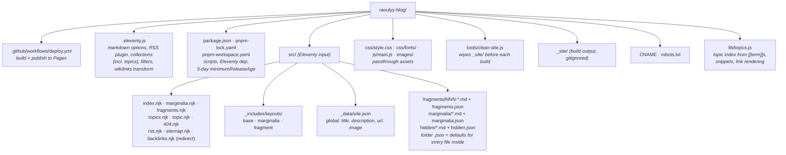
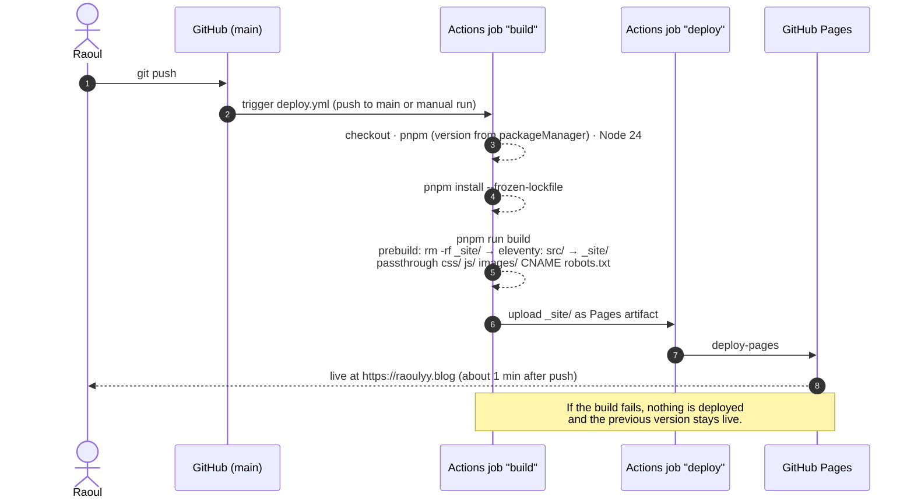
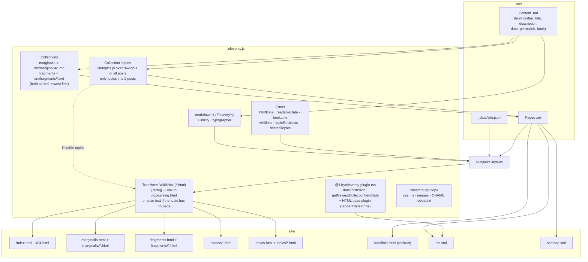
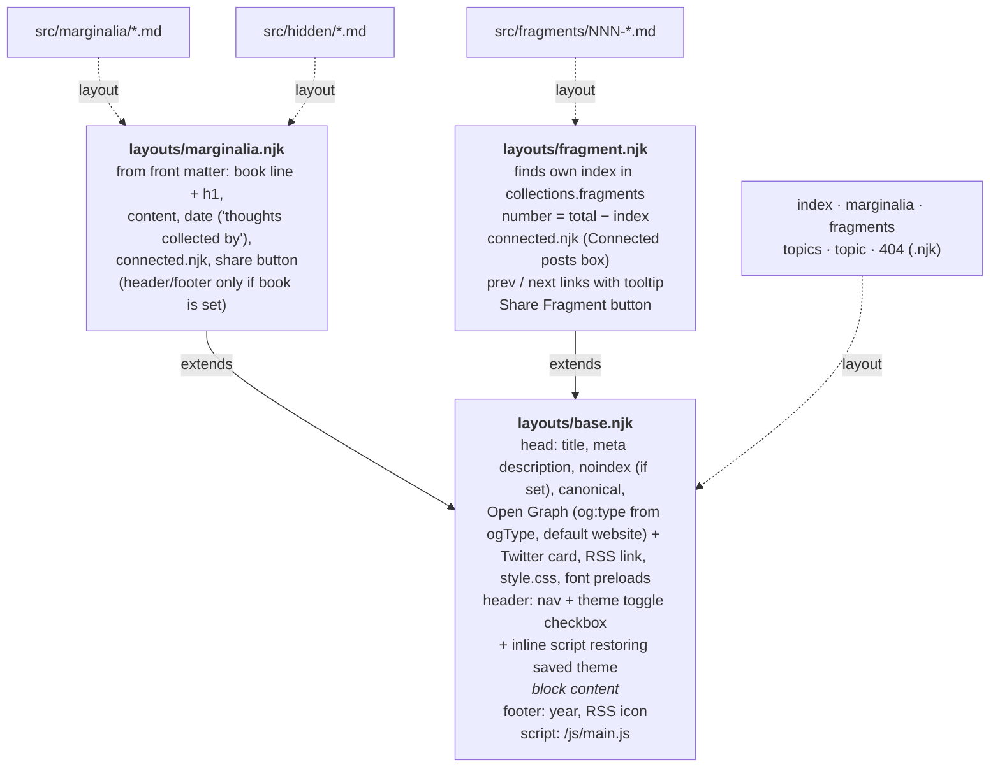
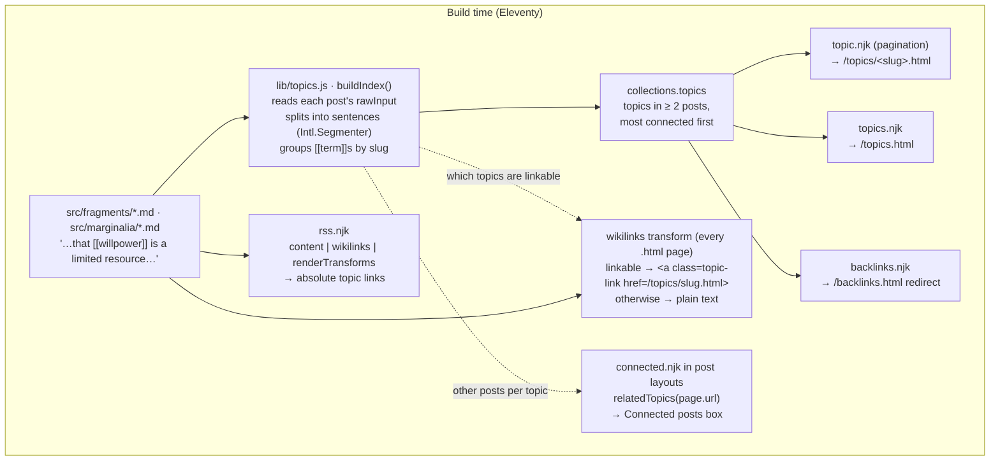
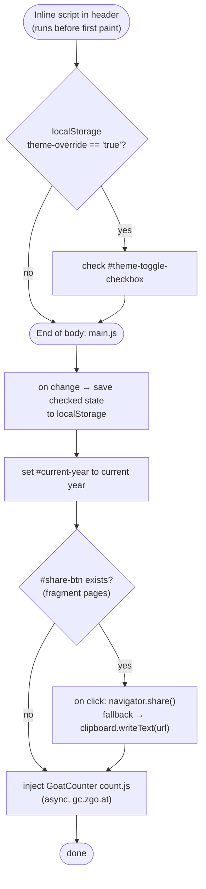
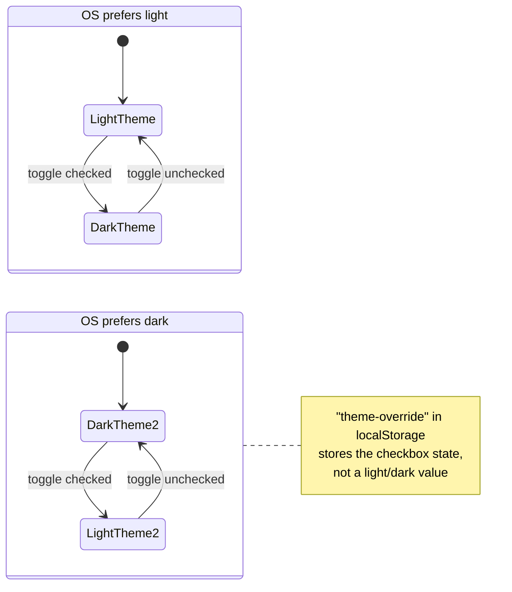
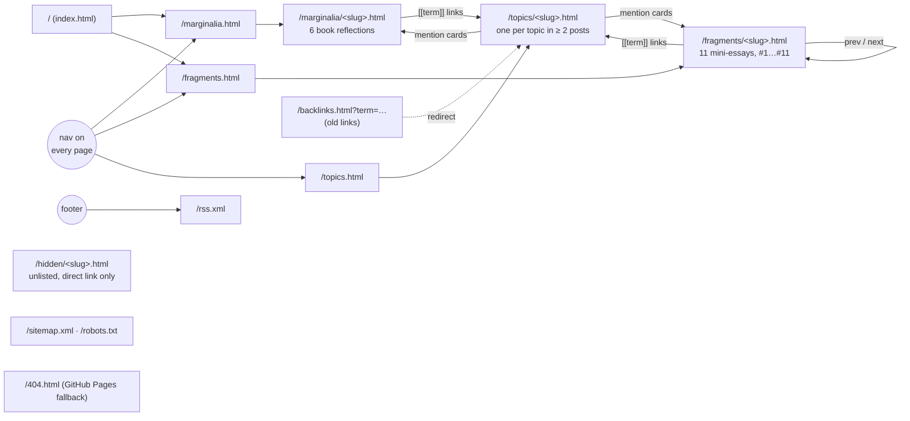

# Architecture

How raoulyy.blog works technically, from writing Markdown to a page in someone's browser.

**In one sentence:** Markdown and Nunjucks sources in `src/` are compiled by Eleventy 3 into `_site/`. On every push to `main`, a GitHub Actions workflow runs that build and publishes `_site/` to GitHub Pages at `raoulyy.blog`. On the client, one small vanilla JS file handles the theme toggle, sharing and analytics. Everything else, including the topic pages, is plain static HTML.

---

## 1. System overview

---

## 2. Repository layout

---

## 3. Build & deploy pipeline

Publishing is just `git push`. GitHub Actions builds the site from a clean checkout and hands `_site/` to GitHub Pages:

All actions in the workflow are pinned to commit SHAs. Two deploys never run at the same time (`concurrency: pages`).

Local scripts:

| Script | What it does |
|---|---|
| `pnpm run build` | `prebuild` (wipe `_site/`) → `eleventy`, same as CI |
| `pnpm run serve` | Eleventy dev server with live reload on `localhost:8080` |

---

## 4. Inside the Eleventy build

### Template inheritance

`rss.njk`, `sitemap.njk` and `backlinks.njk` render without a layout and are excluded from collections.

### Which page reads which data

| Output | Source | Reads |
|---|---|---|
| `/index.html` | `index.njk` | static text |
| `/marginalia.html` | `marginalia.njk` | `collections.marginalia` → title, `book` (split on ` \| `), date |
| `/fragments.html` | `fragments.njk` | `collections.fragments` → number, title, description, date |
| `/fragments/*.html` | `fragment.njk` layout | `collections.fragments` for numbering + prev/next; `relatedTopics` for the Connected posts box |
| `/marginalia/*.html` | `marginalia.njk` layout | `title`, `book`, `date` for header and footer; post content; `relatedTopics` for the Connected posts box |
| `/hidden/*.html` | `marginalia.njk` layout (via `hidden.json`) | excluded from collections, so not listed, not in RSS, topics, or sitemap; `noindex` meta tag |
| `/rss.xml` | `rss.njk` | fragments + marginalia merged, sorted by date, book line for marginalia, full content through `wikilinks` and then `renderTransforms` with `site.url` (absolute links) |
| `/topics.html` | `topics.njk` | `collections.topics` → term, number of posts |
| `/topics/<slug>.html` | `topic.njk` (pagination, one page per topic) | one topic's mentions: post title, snippet sentence, kind, date |
| `/backlinks.html` | `backlinks.njk` | redirect for old links: `?term=…` → matching topic page, else `/topics.html` |
| `/sitemap.xml` | `sitemap.njk` | `collections.all`, so every page except those with `eleventyExcludeFromCollections` (404, hidden, rss, backlinks redirect); includes all topic pages |

---

## 5. Topics (wikilinks)

Writing `[[willpower]]` in a fragment or marginalia post marks *willpower* as a topic. Everything happens at build time, so no JavaScript is involved:

- **A topic gets a page once it connects at least two posts** (`MIN_POSTS` in `lib/topics.js`). Only then do its `[[…]]` mentions become links. Topics used in a single post render as plain text, but they stay indexed and turn into links automatically when a second post mentions them.
- **Each topic page** (`/topics/<slug>.html`) lists every post that mentions the topic, newest first. Each card shows the sentence the term appears in, with the term highlighted.
- **Each post ends with a "Connected posts" box** (`_includes/connected.njk`, included by both post layouts). For every topic in the post that has a page, it lists up to three *other* posts that mention it, plus "+N more" linking to the topic page. Posts without such topics show no box.
- **Aliases:** `[[topic|text]]` shows *text* in the post (and in its snippet) but counts toward *topic*, e.g. `[[story|stories]]`.
- **Spelling variants share one topic.** Topics are keyed by slug, so `[[Willpower]]` and `[[willpower]]` are the same topic. The lowercase spelling is shown unless every mention is capitalized (e.g. *God*, *Paul Tillich*).

The index is rebuilt on every build inside the `topics` collection. Eleventy builds collections before rendering any page, so the transform and the filters always see the current index.

Old `/backlinks.html?term=…` links still work. They exist in feed readers and anywhere someone copied them. The redirect page maps every spelling of a linkable topic to its page, and sends anything else to `/topics.html`.

---

## 6. Client-side runtime (`js/main.js`)

A single script, loaded at the end of `<body>` on every page. The only exception is restoring the saved theme, which happens in a tiny inline script right after the toggle in `base.njk`, so the page never paints in the wrong theme first:

### Theme toggle: CSS only, JS just remembers the choice

The checkbox **inverts** whatever the OS prefers. CSS does the switch with `:root:has(#theme-toggle-checkbox:checked)` inside `prefers-color-scheme` media queries. JS only saves (`main.js`) and restores (inline script in `base.njk`) the checkbox state.

Design tokens (`--bg-color`, `--text-main`, `--accent`, `--text-highlight`, …) are set in `:root` at the top of `css/style.css`. Fonts are self-hosted in `css/fonts/`: iA Writer Quattro 400 for body text, and the variable Fraunces (normal + italic, Latin + Latin Extended, split by `unicode-range`) for `h1`–`h3`. Both are preloaded in `base.njk`. The only third-party request a visitor's browser makes is GoatCounter analytics.

---

## 7. URL map

---

## 8. Content model

| Field | Marginalia | Fragments | Used by |
|---|:-:|:-:|---|
| `layout` | `layouts/marginalia.njk` (set by `marginalia.json`) | `layouts/fragment.njk` (set by `fragments.json`) | Eleventy |
| `title` | ✓ | ✓ | `<title>`, OG/Twitter, listings, RSS, topic pages |
| `description` | ✓ | ✓ | meta description, fragment card subtitle, RSS `<description>` |
| `date` | ✓ | ✓ | sort order, numbering, `<time>`, RSS `pubDate` |
| `permalink` | ✓ | ✓ | output URL (file names like `011-…` don't affect the URL) |
| `book` | `"Title \| Author"` | – | book line on the post, marginalia listing subtitle, RSS (via the `bookLine` filter) |

Fragment numbers (`#11`) aren't stored anywhere. They come from each fragment's position in the date-sorted collection, so adding one with an earlier date renumbers the ones after it.

---

## 9. Observations & quirks

Found while analysing the project. None of them break the site, but they're good to know:

- **Topic snippets come from raw Markdown** with tags and basic Markdown syntax stripped (`lib/topics.js`). Unusual syntax next to a `[[term]]` (e.g. footnotes) could still show up in the snippet text. It's escaped, so it's safe.
